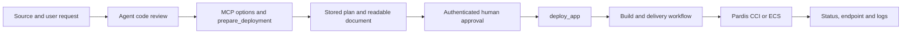

# Application Deployment Development Plan

Date: 2026-10-25. Baseline: application release `v3.0.0`, commit `2f136d2`.
Status: D0 released in v3.1.0. A local advisory planning slice across D1–D3 is implemented;
real-agent acceptance is pending. See [the planning guide](DEPLOYMENT_PLANNING.md) for prompts
and [the D0 test guide](DEVELOPMENT_D0.md) for offline contract checks.

This is the active development roadmap. It supersedes the ECS-only scope and sequencing in
[MVP_PLAN.md](MVP_PLAN.md) and [ECS_IMPLEMENTATION_PLAN.md](ECS_IMPLEMENTATION_PLAN.md).
Those documents remain historical references, including useful failure-handling scenarios.
Requirements originate from Role 2 — MCP (PAR-18 through PAR-31), with the user's scope decisions
below taking precedence. Keep real endpoints, account/resource IDs, source code, and secrets out
of this public document and its test evidence.

## 1. Agreed outcome and boundaries

A user provides application source to an MCP-capable agent. The agent reviews the code and uses
MCP tools to prepare a readable deployment document recommending Pardis services and resources.
After approval, MCP executes the stored plan with the user's authorized access, tracks the actual
deployment, and exposes its endpoint and bounded application logs.

- Preserve the current HTTP transport, Central Auth login, identity provider federation, encrypted
  Redis sessions, per-user temporary cloud credentials, and existing read-only tools.
- Every authenticated user may use planning tools and access their own code-review drafts. Reader
  and full users have the same MCP tool catalog. Verified `pardis_roles` identify team/access level
  through the existing federation mapping: readers cannot write cloud resources; full users may write
  within their team's actual Pardis grants. Recheck cloud permissions for each operation; a plan or
  a tool's presence grants nothing. Do not hardcode team roles as a planning allowlist.
  `Department`, `Team`, `Venture`, and `Vertical` are display metadata, never authorization inputs.
- Retain actor identity (`issuer` + `subject`) internally for ownership, approval and audit even though
  `whoami` hides technical details by default. Never accept actor identity or roles from tool arguments.
- Support both CCI and ECS as deployment targets. The first release need not implement every API:
  distinguish services that can be recommended from services that can actually be provisioned.
- Keep resource selection flexible within supported, tested capabilities and the user's permissions.
  Initial small/private test presets are rollout controls, not a permanent product restriction.
- The agent performs semantic code review and explains recommendations. MCP supplies facts, validates
  structured requests, stores plans, and executes operations. No embedded LLM service is required.
- Keep cloud credentials inside the trusted backend. The existing ID-token exchange with configured
  Pardis IAM remains intentional; never forward the portal/MCP bearer token to workload APIs.
  Record this federation exception explicitly when closing PAR-18's credential-forwarding criterion.
- Source code and repository instructions are untrusted input. Reviewing a repository does not authorize
  running its scripts. Builds execute only in an isolated, approved build environment.

## 2. Verified starting point

| Capability | Current evidence | Limit |
| --- | --- | --- |
| Authentication and federation | Implemented; user-confirmed real login and ECS listing | Accepted foundation for this roadmap, not a claim of production certification |
| Role-based cloud isolation | HR role saw the test ECS; replacing it with Marketing denied explicit HR access and returned an empty permitted list | Positive Marketing access to an existing Marketing resource was not tested |
| Identity tool and session freshness | Current verified claims and per-request upstream refresh implemented in v3.3.1 | Signed-JWT and concurrency tests pass; live Central Auth/Pardis acceptance pending; no push-event cancellation of in-flight cloud requests |
| Existing toolset | `whoami`, `list_projects`, `list_ecs`; YAML selection | No source review, deployment, approval, application catalog or CCI adapter |
| Tests and release | 83 local tests passed; v3.0.0 CI and image publication succeeded | Cloud writes and new workflows remain untested |
| Storage and operations | Encrypted Redis sessions, basic health, ECS audit events | No durable deployment ledger, comprehensive audit or alerting yet |

Do not reopen authentication design as a prerequisite to planning work. Preserve its behavior with
regression tests and track existing limitations separately. Integrating a future portal still needs
a client-level acceptance test; a new portal architecture is not part of the first iteration.

## 3. Delivery rules and progress tracking

Implement one stage at a time. Each stage ends with automated tests, a repeatable manual demo,
sanitized evidence, and a review before selecting the next stage. Do not bundle all stages into one
release. Record the tested commit/image, result, known limits and next action in the table below.
Commit, push and deployment follow the user's instructions for that stage; a completed local stage
does not itself authorize a release or cloud mutation.

| Stage | Deliverable | Status | Acceptance evidence |
| --- | --- | --- | --- |
| D0 | Contracts and synthetic application fixtures | Released v3.1.0 | `tests/test_deployment.py`, JSON examples and [D0 test guide](DEVELOPMENT_D0.md) |
| D1 | Cloud access scope and deployment options | Partial: advisory options and v3.3.0 read-only ECS catalogs implemented; live acceptance and target bindings pending | `tests/test_planning.py`, `tests/test_discovery.py`, [discovery guide](ECS_DISCOVERY.md) |
| D2 | Source assessment intake | Advisory intake implemented in `prepare_deployment`; source registry/provenance verification pending | Valid/incomplete assessment HTTP tests; real-agent review pending |
| D3 | Stored plan and Markdown deployment document | Owner-only preview implemented; execution-ready binding pending | Encrypted persistence, role/owner isolation, expiry, CCI/ECS documents; manual acceptance pending |
| D4 | Approval, quota and idempotent operation state | Not started | — |
| D5 | Build/delivery adapter and verified artifact | Not started | — |
| D6 | First live CCI or ECS deployment path | Not started | — |
| D7 | Second deployment target | Not started | — |
| D8 | Access-controlled application logs | Not started | — |
| D9 | End-to-end acceptance and operational handoff | Not started | — |

Milestone A: D0–D3, source to reviewed document, zero cloud mutations.
The current preview demonstrates this user flow, but does not yet verify authorized cloud target
bindings or source provenance. Do not treat it as a deployable plan or full D1–D3 completion.
Milestone B: D4–D6, approved plan to one healthy real application.
Milestone C: D7–D9, both targets, logs, isolation and recovery acceptance.
Do not promise delivery dates until build integration and target API access are verified.

## 4. Proposed contracts

Names and schemas are proposed and become fixed with tests in D0. Extend the existing catalog;
do not replace existing tools or introduce a general-purpose command-execution tool.

| Tool | Input outline | Output and behavior |
| --- | --- | --- |
| `get_deployment_options` | None | Implemented: advisory CCI/ECS targets, review stacks and fixed suggestions for all authenticated users; live bindings pending |
| `list_ecs_options` | Typed query selecting catalog, pagination and supported filters | Implemented in v3.3.0: real ECS/network/image/EPS catalog pages using the user's temporary credentials; no provisioning or execution binding |
| `prepare_deployment` | Agent assessment, application name, candidate target | Implemented: owner-only draft, expiry and readable Markdown; fixed advisory sizing, no provisioning |
| `get_deployment_plan` | Optional `plan_id`; omit for latest | Implemented: owner-authorized exact saved document with active-session check |
| `deploy_app` | `plan_id`, `idempotency_key` | Existing or newly submitted `operation_id`; no replacement deployment parameters or caller-provided approval boolean |
| `get_deployment_status` | `operation_id` | Actual stages, resource identifiers and endpoint when verified |
| `get_app_logs` | Application identifier, bounded time range and result limit | Authorized, redacted logs with truncation information |

Records needed, added only as their stage requires them:

- **Cloud access:** the existing federation maps `pardis_roles` to team and reader/full IAM grants.
  A target binding contains the regional IAM project and applicable Enterprise Project/CCI scope.
  Operator catalogs may describe approved placement and supported recipes, but must not introduce
  a separate allowlist for using planning tools or replace cloud IAM enforcement. D0 role-policy
  fixtures are historical schema examples, not the live authorization mechanism.
- **Application record:** actor owner, access-policy binding, source reference and resource identifiers.
  Other users may access it only through an explicit role-based sharing rule. Never trust an arbitrary
  application/artifact/operation ID merely because the caller supplied it.
- **Source assessment:** source revision/digest, evidence and review findings with provenance.
- **Deployment plan:** schema version, actor, app, source revision, normalized dependency graph,
  build recipe, target settings, secret references, checks, policy version, hash and expiry.
- **Approval:** approver, requester, plan hash, action, decision, expiry and policy version.
- **Operation:** actor/app/plan linkage, idempotency key and request hash, workflow ID, stages,
  artifact digest, cloud request/resource IDs, timestamps and safe failure information.

Use immutable revisions and registry digests rather than mutable branches or image tags for execution.
No secrets, arbitrary shell commands, caller-selected service endpoints or raw credentials in plans.

## 5. Stage-by-stage implementation

### D0 — Define contracts and fixtures

Implement typed models for source assessment, role policy, application binding and deployment plan;
add a sample application with no real credentials and a second deliberately invalid fixture. Keep
proposed settings in examples until they are actually supported by the config loader.

Decisions to record now: source input shape, ownership/sharing defaults, supported initial stack,
resource preset bounds, and output document sections. Build provider and live target choice may wait
until D5/D6; use explicit unresolved fields rather than inventing capabilities.

- Automated: valid/invalid models, unexpected fields, size bounds, missing revision and secret-value
  rejection; organization attributes cannot override actor or role scope.
- Manual: validate the two fixtures locally and inspect the normalized output without cloud access.
- Exit: contracts and examples reviewed; invalid fixture rejected; no new live tools or writes.

### D1 — Cloud access scope and deployment options

Keep planning available to every authenticated user and drafts owner-only. Use the existing
federation and user-scoped credentials to discover actual cloud access. Reader/full roles describe
cloud permissions, not tool visibility. Do not infer authority from a role suffix or organization
attribute, and do not introduce duplicate per-team planning grants in YAML.

Expose `get_deployment_options` with an explicit distinction between advisory suggestions and
live-verified accessible placement. Readers can plan deployments but cannot execute writes. Full
users can execute only supported operations in their authorized team scope, after plan validation
and approval. A full role does not bypass IAM, quota or supported-adapter limits.

- Automated: reader/full both plan, cross-user draft denial, anonymous/revoked session denial,
  disabled tools and invalid config. Later write adapters must test reader denial, permitted full
  writes and cross-team denial, without shared administrator credentials.
- Manual: compare planning as reader and full, then compare live resource visibility with Console.
- Exit: predictable cloud scope, independent planning access and secret-free audit events.

### D2 — Source intake and agent-assisted code review

Initially let the agent inspect a user-selected workspace/repository using its existing read access.
It submits a bounded assessment with manifest observations through `prepare_deployment`; a separate
assessment-submission tool is unnecessary for the preview. The MCP
server does not fetch arbitrary URLs or read client-provided filesystem paths. Link private repository
references to an operator-approved source registry. Treat the submitted analysis as advisory evidence.

Capture language/framework, build/start commands as review data, ports, health endpoints, dependencies,
stateful storage, workers, config names, blockers and file references. Distinguish observed facts,
model inferences and missing information. Secret values must not be part of the review payload.
The actual build recipe must later be selected from supported templates, not executed from this text.

- Automated: size/file-count limits, source ownership, unsupported references, injected instructions,
  sensitive fixture handling and evidence preservation. Never run package installation or scripts.
- Manual: ask the agent to review the valid fixture, then the fixture with missing configuration.
  Inspect the returned findings and unresolved dependencies.
- Exit: source to traceable assessment works, with zero build or cloud operations.

### D3 — Deployment plan and readable document

Implement `prepare_deployment` and `get_deployment_plan` for every authenticated user. Resolve
advisory choices against the assessment and supported capabilities; distinguish actual cloud-access
checks from the right to prepare a document. Store the canonical plan encrypted in Redis and render
Markdown from that same record. Store the document or its reproducible version with the plan.

Document: review summary/blockers, proposed CCI/ECS architecture and rationale, services and dependency
order, CPU/RAM/disk, networking/exposure, env names and secret references, build/deploy stages, cost
and quota provenance, required approvals, health verification and rollback/cleanup responsibilities.

Show missing data as unknown, never as zero cost or passed quota. A draft may explain unsupported
services, but it must be explicitly non-executable until every required capability and input is resolved.
Plan creation is neither provisioning nor a capacity reservation. Editing choices creates a new plan
hash; the document is not a second source of execution parameters.

- Automated: deterministic document/plan agreement; CCI and ECS fixture plans; wrong app/artifact,
  out-of-policy sizes, unsupported services, expiry and cross-user access. Assert zero write calls.
- Manual: request a deployment plan for the fixture, read its Markdown, change the target/preset and
  verify a new plan is produced. Another role must not retrieve the original private plan.
- Exit: Milestone A demo passes. The user can review a useful deployment document before writes exist.

### D4 — Approval and operation lifecycle, using fake execution

Add `deploy_app` and `get_deployment_status` against a fake adapter first. Live writes remain disabled
by default and require explicit tool enablement plus an execution switch. A wildcard must not enable
new cloud writes implicitly.

Implement an authenticated backend approval endpoint with a minimal browser review/confirm page,
reusing the existing identity flow where possible. Approval POSTs require browser/CSRF binding.
The agent may return an approval link, but cannot create approval through a model-supplied boolean.
Requester self-approval is allowed only where policy permits; elevated actions require an approver
role. A later portal can use the same approval contract. Client-side tool approval is additional UX,
not backend evidence of the human's decision.

Recheck current session, role policy, target scope, quota and cost at execution. Bind approval to the
exact requester/app/action/plan hash and expiry. Current roles require a new online session check at
actual execution, including queued/resumed operations. Do not reuse an earlier request's authentication
context or promise cancellation of a cloud request already sent. See [session lifecycle](AUTH_SESSION_LIFECYCLE.md).

Before any submission, atomically persist/claim the operation and its idempotency key. Same actor/key
and same request return the existing operation; changed parameters with the same key are rejected.
Bind the plan to its operation so a new key cannot deploy the same approved plan twice. Coordinate
quota reservations for concurrent MCP operations; still recheck upstream quota and handle races from
other cloud clients. Quota/cost data must include source and freshness; block execution when required
checks are missing/stale. An unavailable cost estimate needs an explicit bounded policy exception,
never an implicit approval. Revalidate confirmed inputs before consuming approval/reserving resources.

Use persistent, non-evicting operation/approval storage with retention independent of session TTL.
Redis can serve the initial controlled MVP if restart/recovery tests establish these properties.
Unresolved operations cannot silently expire. Restart or response loss must not resubmit unknown work.
Retry only classified transient failures; retry writes only when upstream idempotency/reconciliation
has been verified. Polling timeout does not mean the deployment failed.

- Automated: approval rejection/expiry/replay, edited plan, cross-user IDs, concurrent duplicate calls,
  different keys for one plan, quota races, Redis loss and restart around submission, bounded retries,
  timeout after upstream acceptance and session revocation.
- Manual: approve and reject fake plans, call deploy twice, restart MCP, and recover the same operation.
- Exit: no duplicate fake operations; no submission without valid policy/approval; failures remain visible.

### D5 — Build and delivery integration

Choose one existing build/delivery system and implement a small adapter for start/status/artifact
lookup. Agree its API, authentication, callback validation or polling, and correlation IDs. Reuse an
existing platform rather than adding a workflow engine inside MCP.

Fetch only approved repositories at the plan's immutable revision in an isolated build environment.
Verify actual source against the assessment; material mismatches return to planning/approval. Restrict
build settings to approved recipes, separate build secrets from source, and publish to an approved
registry. Record the resulting immutable image digest and its source/build provenance. Build completion
is not deployment success.

Before live deployment, decide and document how asynchronous cloud steps retain user delegation.
Do not put tokens into job parameters, logs or operation records, or introduce a shared admin identity.
The build runner should not receive Pardis credentials. A cloud step requiring expired user credentials
must expose an authentication-required stage and resume safely after re-login; never restart the whole
operation. Verify the delivery system can preserve this boundary before choosing it.

- Automated: unauthorized source/registry, tampered callbacks, source mismatch, build failure/timeout,
  duplicate starts and credential redaction. Mock delivery state must map to the same operation contract.
- Manual: build the synthetic fixture with no cloud deployment, verify revision/image digest, then
  force a harmless fixture build failure and inspect the reported stage.
- Exit: a real verified artifact and tracked workflow exist; no arbitrary source execution in MCP.

### D6 — First live deployment target

Choose CCI or ECS after read-only capability discovery and confirming the test environment; record
the choice and why. Before selecting an SDK/API, verify Pardis endpoints, per-user temporary credential
support, required permissions, target-scope isolation, quota queries and actual create/status behavior.
Huawei API similarity alone is not evidence for optional dry-run or idempotency support.

- CCI path: resolve the authorized runtime scope/network, deploy the pinned image with bounded resource
  settings and secret references, then inspect actual workload readiness and the configured health check.
- ECS path: resolve image/flavor/network/security group/key pair, create the instance, then install/start
  the approved application artifact through an agreed bootstrap/delivery mechanism. An ACTIVE VM alone
  does not mean the application was deployed. No generic agent-controlled SSH/shell tool or private key
  in prompts; fix and review the bootstrap recipe in the adapter.

Initially deploy one small private fixture app; record cleanup ownership and identify reused versus
new resources. Partial failure reports created resources and cleanup needs. Never delete shared
resources as an automatic rollback. Public exposure and deletion stay disabled until their specific
parameter-bound approval rules and adapters are implemented and tested.

- Automated: SDK payload and immutable artifact selection, denied permissions, partial creation,
  ambiguous timeout, duplicate request, expired credentials and false readiness.
- Manual: approve one plan, follow the operation, reach the application health endpoint, compare real
  resources to the plan, and repeat deploy without producing a second deployment.
- Exit: Milestone B passes with real user-scoped resources and an actually healthy application.

### D7 — Add the second target

Implement the remaining CCI/ECS adapter behind the same plan/operation contracts. Add only the SDKs
required by verified APIs. Do not clone authorization, approval or idempotency logic per target.
Update options to advertise the second target as executable only after its live acceptance passes.

- Automated: run common adapter-contract cases for both targets; reject unsupported target-specific
  combinations and cross-scope resource selectors.
- Manual: deploy the same fixture on the other target, verify health, repeat the duplicate and denied
  scope scenarios, and inspect the target-specific steps in the document.
- Exit: both CCI and ECS have recorded live evidence; optional dependencies get their own adapter gates.

### D8 — Application logs

Implement `get_app_logs` through the approved log backend/target adapter. Resolve workload selectors
from the server-side application record; never accept arbitrary namespaces, hosts or filesystem paths.
Set maximum time range, lines, bytes and query timeout. Apply configured sensitive-value redaction
before tool output and audit; document that pattern redaction cannot detect every possible secret.

- Automated: foreign/missing app IDs, excessive queries, selector tampering, secret fixtures,
  multiline entries, truncation and upstream failures.
- Manual: retrieve fixture logs on both targets and confirm a different unauthorized role cannot read
  them. Use synthetic secrets for redaction checks, never real credentials.
- Exit: bounded useful logs with no unauthorized application data.

### D9 — Acceptance, monitoring and handoff

Complete audit coverage for every new tool and deny path. Correlate issuer/subject, role-policy
decision, application, plan/operation, approval, workflow/cloud request IDs and safe outcome. Do not
log bearer tokens, raw source, Secret values or unfiltered upstream exceptions. Restrict audit access.

Add latency/error metrics, workflow age/stuck-operation signals, Redis/dependency health and named
alert ownership. Keep private runbooks for authentication-required recovery, quota denial, upstream
outage, partial failure, unknown submission, credential expiry and cleanup. Avoid high-cardinality
actor/application IDs in metric labels. No new auth architecture is implied by this stage.

- Automated: end-to-end valid/denied flows, swapped app/artifact/operation IDs, forged roles, approval
  tampering, process restart, upstream failure and duplicate/concurrent deployment scenarios.
- Manual: code review -> document -> approve -> build -> deploy -> healthy endpoint -> logs on both
  targets; negative tests across two role scopes; recovery after re-login; operator alert demonstration.
- Exit: sanitized evidence, tested image/config, rollback instructions, cleanup inventory and operator
  ownership are recorded. This establishes MVP acceptance, not blanket production readiness.

## 6. Suggested code boundaries

Keep the current repository and backend. Add modules incrementally when a stage needs them:

| Existing/new location | Responsibility |
| --- | --- |
| `auth.py` (existing) | Reuse authenticated sessions and verified claims |
| `toolset.py` (existing) | Tool contracts, annotations and registration |
| `config.py` (existing) | Typed role/preset/capability config; live-write opt-in |
| `cloud.py` (existing) | Reuse IAM exchange and current ECS read integration |
| `authorization.py` (new) | Shared role/action/target/ownership decisions |
| `deployment.py` (new) | Assessment, plan, approval and operation lifecycle; Redis records |
| `deployment_document.py` (new) | Render the canonical plan as Markdown |
| `delivery.py` (new) | Chosen build/workflow adapter |
| `targets/ecs.py`, `targets/cci.py` (new) | Target-specific execution and verification, when needed |
| `tests/fixtures/` (new) | Synthetic source, plans and failure scenarios |

This is a responsibility map, not a requirement to scaffold empty files or create a framework.

## 7. Requirements coverage and completion evidence

| Requirement | Stages | Completion evidence |
| --- | --- | --- |
| PAR-18 Authentication | Existing foundation; D1/D9 integration | Valid/expired/incorrectly scoped client tests; documented IAM federation exception |
| PAR-19, PAR-31 Authorization/isolation | D1 and every later tool | Role-bound app/artifact/resource checks; deny audit; no attribute-derived grants |
| PAR-20 Plan | D2–D3 | Source-linked document, validated canonical plan, zero provisioning |
| PAR-21 Deployment | D4–D7 | Approved operation reaches real application health through delivery workflow |
| PAR-22 Status | D4–D7 | Actual backend stages; unknown/timeout/re-login recovery |
| PAR-23 Logs | D8 | Authorized, bounded and redacted application logs |
| PAR-24 Quota/cost/approval | D3–D6 | Freshness policy, execution rechecks, bound approval and concurrency tests |
| PAR-25 Idempotency/retries | D4–D7 | Duplicate/restart/ambiguous outcome tests; no blind write retry |
| PAR-26 Audit | D1 onward; D9 closure | Correlated successful and denied calls without sensitive values |
| PAR-27 Tests | Every stage; D9 closure | Recorded automated and live positive/negative evidence |
| PAR-28 Operations | D9 | Health/metrics/alerts, recovery runbooks and named operators |
| PAR-29 High-impact actions | D4/D6 onward | Protected action list, disabled unimplemented actions, exact-plan approvals |
| PAR-30 Validation | D0 onward | Server-side schema, policy and size checks before side effects |

## 8. First implementation session

D0 is implemented with contracts, role-policy examples and synthetic fixtures. Run the
[offline demo](DEVELOPMENT_D0.md) and review the assessment/plan shape together. No cloud resources,
build jobs, portal rewrite or new authentication flow are required. Proceed to D1 after that shape
is agreed; passing schema tests alone does not establish authorization or cloud compatibility.
